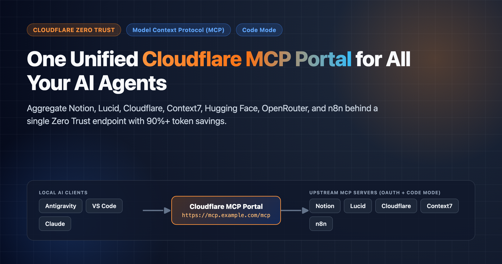
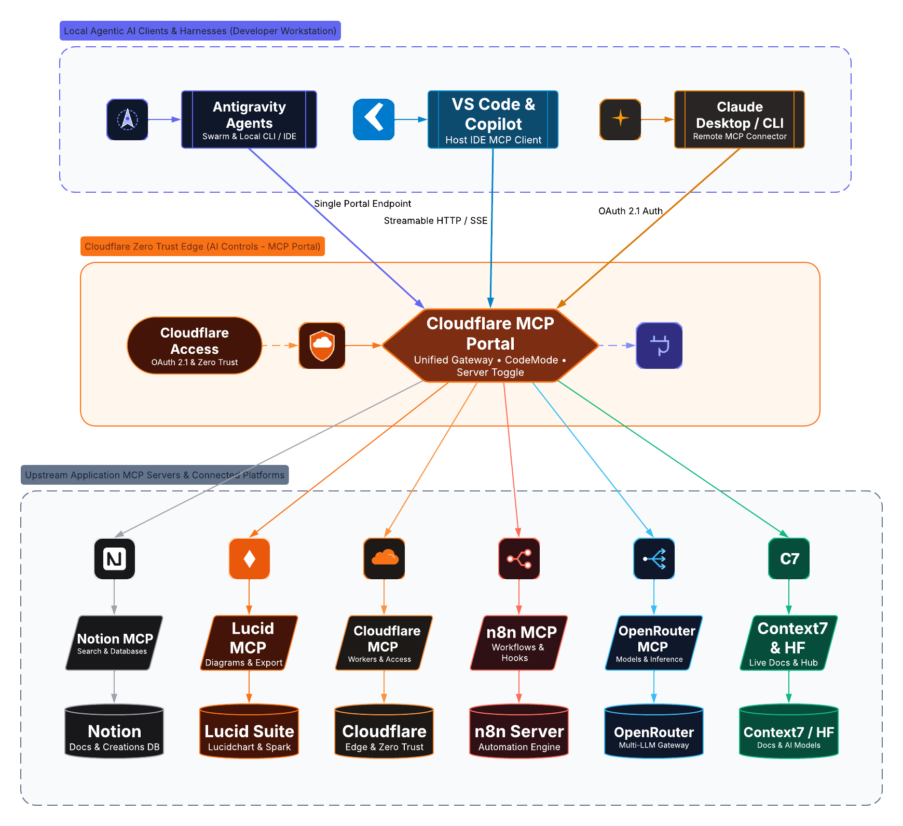
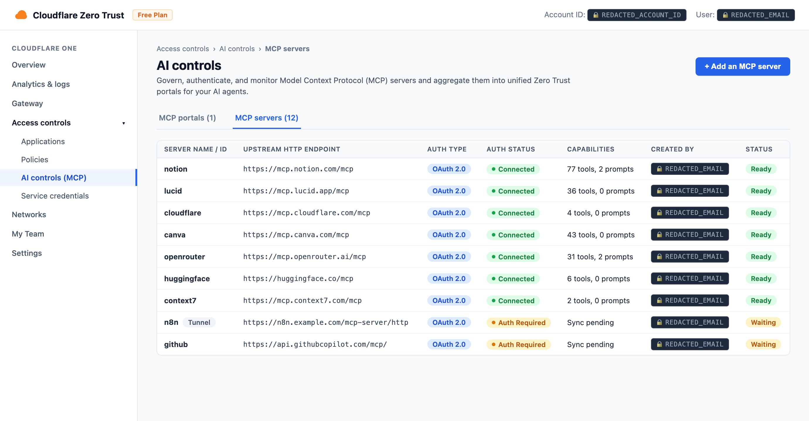
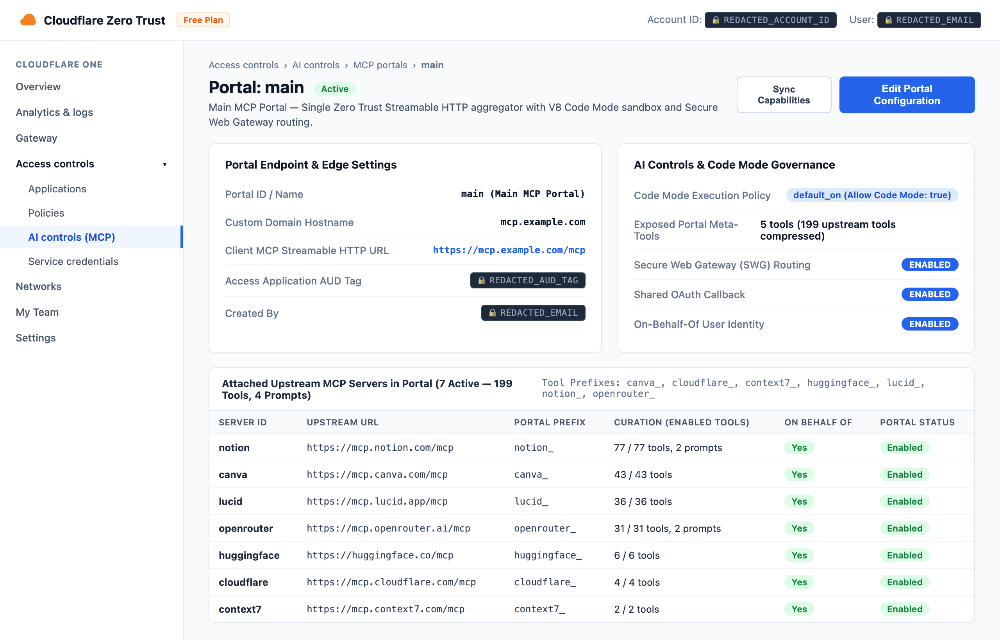
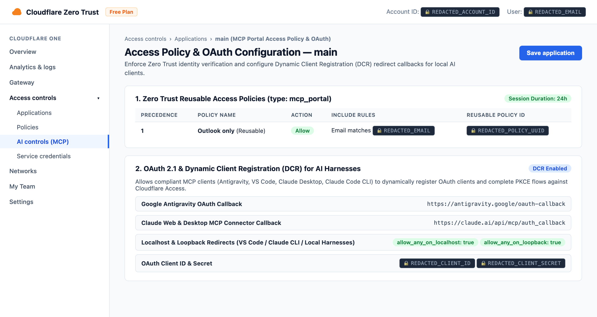

If you build daily with AI agents across **Antigravity**, **Visual Studio Code**, **Claude Desktop**, and **Claude Code**, your local Model Context Protocol (MCP) configuration probably suffers from **MCP sprawl**.

Before long, a typical developer workstation accumulates a dozen or more point-to-point MCP connections: **Notion** for knowledge bases, **Lucid** for architecture diagrams, **Cloudflare** for edge infrastructure, **Context7** for live library documentation, **Hugging Face** for model hubs, **OpenRouter** for multi-model inference, **Canva** for visual assets, and self-hosted **n8n** workflows running over a local cluster.


*Aggregating upstream SaaS and self-hosted MCP servers behind a single Cloudflare Zero Trust MCP Portal endpoint*

Managing those integrations individually across four or five local AI clients creates three immediate engineering headaches:

1. **Configuration & OAuth Duplication**: Every time you add, rotate, or re-authenticate an MCP server, you must update separate JSON files (`~/.gemini/config/mcp_config.json`, `.vscode/mcp.json`, `claude_desktop_config.json`, `~/.claude/mcp_config.json`, `~/.cursor/mcp.json`) and complete redundant OAuth handshakes per client.
2. **Context Window Bloat**: Loading 7 to 10 upstream MCP servers directly into an agent session dumps **nearly 200 raw JSON tool schemas** into the LLM's system prompt on every single turn—burning 15,000+ tokens before you even type your first question.
3. **Fragmented Governance & Shadow AI**: Direct client-to-SaaS connections bypass centralized identity enforcement, session duration limits, tool curation, and unified audit logging.

**Cloudflare MCP Server Portals**—part of **Cloudflare Zero Trust Access (AI Controls)**—solve all three problems at the edge. By placing a single identity-aware portal (`https://mcp.example.com/mcp`) in front of your upstream MCP servers and enabling **Code Mode**, you collapse 199 upstream tools into **5 lightweight meta-tools** secured by Cloudflare Access SSO and OAuth 2.1 Dynamic Client Registration (DCR).

In this end-to-end guide, I'll walk through the architecture, Cloudflare Zero Trust dashboard setup, security policies, and local client configurations to connect Antigravity, VS Code, and Claude to a unified Cloudflare MCP Portal.

---

## Architecture Overview: One Front Door with Code Mode

Instead of every local AI harness maintaining $N \times M$ direct connections to every upstream MCP server, the Cloudflare MCP Portal acts as an identity-aware aggregation proxy and V8 sandboxed execution engine at the Cloudflare edge.


*End-to-end architecture created in Lucidchart showing Local Agentic AI Clients routing through the Cloudflare Zero Trust MCP Portal to upstream MCP servers ([Open interactive diagram in Lucidchart](https://lucid.app/lucidchart/3b602dfb-23b1-480e-a754-294ce92ebe03/edit?invitationId=inv_627c8084-79d4-4dd7-8ff0-51187e3f1a90&referringApp=other+mcp+clients))*

### How the 3-Tier Architecture Works

1. **Tier 1 — Local Agentic AI Clients & Harnesses (Developer Workstation)**:
   - **Antigravity Agents** (Swarm & local IDE/CLI), **VS Code & GitHub Copilot** (Host IDE MCP client), and **Claude Desktop / Claude Code CLI** connect via **Streamable HTTP** to a single portal URL: `https://mcp.example.com/mcp`.
2. **Tier 2 — Cloudflare Zero Trust Edge (`AI Controls -> MCP Portal`)**:
   - **Cloudflare Access (`type: mcp_portal`)** intercepts inbound agent connections, enforcing OAuth 2.1 PKCE flows, Dynamic Client Registration (DCR), and reusable Zero Trust identity policies (e.g., One-Time PIN or corporate SSO).
   - **Code Mode Engine (`code_mode: default_on`)** prevents context window pollution by exposing only 5 portal meta-tools to the client while keeping upstream tool definitions indexed at the edge.
   - **Secure Web Gateway (SWG)** logs every tool call, prompt retrieval, and upstream request for centralized observability.
3. **Tier 3 — Upstream Application MCP Servers & Connected Platforms**:
   - The portal routes authenticated tool calls on behalf of the user (`on_behalf: true`) to public SaaS MCP endpoints (**Notion**, **Lucid**, **Cloudflare**, **Canva**, **OpenRouter**, **Hugging Face**, **Context7**) as well as private self-hosted services (**n8n**) exposed through a Cloudflare Zero Trust Tunnel.

### Direct Sprawl vs. Cloudflare MCP Portal + Code Mode

| Architectural Dimension | Direct Multi-Server Config ($N$ Servers) | Cloudflare MCP Portal + Code Mode |
| :--- | :--- | :--- |
| **Client Endpoints to Manage** | 7–15 separate URLs / `stdio` processes per IDE | **1 unified Streamable HTTP URL** (`https://mcp.example.com/mcp`) |
| **Tool Schemas Loaded in Context** | **199 tools + 4 prompts** (~18,000+ tokens upfront) | **5 portal meta-tools** (~1,100 tokens — **>93% token reduction**) |
| **Upstream Authentication** | Repeated OAuth flows in every local client | **Single edge OAuth session** (`on_behalf: true`) managed by Cloudflare |
| **Tool Execution Concurrency** | Sequential turn-by-turn LLM tool calls | **Parallel JavaScript execution** (up to 4 concurrent upstream calls via `Promise.allSettled`) |
| **Security & Auditing** | Fragmented across individual SaaS vendors | **Centralized Cloudflare Access policies** + SWG timeseries analytics |

---

## Step 1: Registering Upstream MCP Servers in Cloudflare Zero Trust

To build an MCP Portal, you first register the upstream MCP servers you want Cloudflare to govern.

1. Log in to the [Cloudflare Dashboard](https://dash.cloudflare.com/) and open **Zero Trust** (**Cloudflare One**).
2. In the left sidebar, navigate to **Access controls** $\rightarrow$ **AI controls** (also accessible under **MCP Portals**).
3. Select the **MCP servers** tab and click **+ Add an MCP server**.


*Cloudflare Zero Trust dashboard (`Access controls -> AI controls -> MCP servers`) showing registered SaaS and self-hosted upstream MCP servers with sensitive account IDs and emails redacted*

For each upstream integration, provide a clean **Server ID** (which becomes the tool prefix inside the portal, such as `notion_` or `lucid_`), its **Streamable HTTP Endpoint**, and its authentication type:

| Server ID (Portal Prefix) | Upstream HTTP Endpoint | Auth Type | Capabilities Synced | Role in Agent Workflow |
| :--- | :--- | :---: | :---: | :--- |
| `notion` (`notion_`) | `https://mcp.notion.com/mcp` | OAuth 2.0 | 77 tools, 2 prompts | Docs, wikis, Notion Memory, and `Creations` database management |
| `lucid` (`lucid_`) | `https://mcp.lucid.app/mcp` | OAuth 2.0 | 36 tools, 0 prompts | Creating, validating, and exporting Lucidchart & Lucidspark diagrams |
| `canva` (`canva_`) | `https://mcp.canva.com/mcp` | OAuth 2.0 | 43 tools, 0 prompts | Generating, resizing, and exporting brand designs and covers |
| `openrouter` (`openrouter_`) | `https://mcp.openrouter.ai/mcp` | OAuth 2.0 | 31 tools, 2 prompts | Querying live LLM pricing, uptime, benchmarks, and multi-model inference |
| `huggingface` (`huggingface_`) | `https://huggingface.co/mcp` | OAuth 2.0 | 6 tools, 0 prompts | Exploring models, datasets, Spaces, and AI papers on the Hugging Face Hub |
| `cloudflare` (`cloudflare_`) | `https://mcp.cloudflare.com/mcp` | OAuth 2.0 | 4 tools, 0 prompts | Searching Cloudflare docs and executing OpenAPI infrastructure operations |
| `context7` (`context7_`) | `https://mcp.context7.com/mcp` | OAuth 2.0 | 2 tools, 0 prompts | Fetching version-accurate documentation for libraries and frameworks |
| `n8n` (`n8n_`) | `https://n8n.example.com/mcp-server/http` | OAuth 2.0 | Self-Hosted Tunnel | Triggering private local automation workflows over Cloudflare Tunnel |

> [!TIP]
> **Mixing Public SaaS and Private Self-Hosted Servers**
> Because Cloudflare Zero Trust already terminates our encrypted `cloudflared` tunnel from our local Raspberry Pi cluster (`n8n.example.com`), registering `https://n8n.example.com/mcp-server/http` as an upstream MCP server lets cloud and local tools sit behind the exact same Access policy without opening a single router port.

When you click **Save and connect server**, Cloudflare performs the OAuth handshake with the upstream provider (using Cloudflare's shared OAuth callback when `is_shared_oauth_callback_enabled: true`) and indexes the server's tools and prompt templates.

---

## Step 2: Creating the MCP Portal & Enabling Code Mode

Once your upstream servers show a **Ready** status, switch to the **MCP portals** tab and click **Add server portal**.


*Configuring the `main` MCP Portal at `mcp.example.com` with Code Mode (`default_on`), Secure Web Gateway routing, and 7 active upstream servers (199 tools compressed into 5 meta-tools)*

### Key Portal Configuration Settings

1. **Portal ID & Display Name**: Set a clean identifier (e.g., `main` — *Main MCP Portal*).
2. **Custom Domain Hostname**: Select an active Cloudflare zone (`example.com`) and assign a subdomain (`mcp.example.com`). Cloudflare automatically routes `https://mcp.example.com/mcp` through its Anycast edge.
3. **Code Mode Policy (`code_mode: "default_on"`)**:
   - With `allow_code_mode: true` and `code_mode: "default_on"`, Cloudflare compresses all 199 upstream tool definitions behind a secure JavaScript sandbox.
   - Instead of sending 199 tool schemas to your IDE, the portal exposes only **5 meta-tools**:
     - `portal_list_servers`: Lists all upstream MCP servers attached to the portal along with their IDs, names, and enabled status.
     - `portal_toggle_single_server`: Enables (`"toggle"`) or disables (`"untoggle"`) a specific upstream server by `server_id` on demand.
     - `portal_toggle_servers`: Generates an interactive browser URL allowing the user to toggle multiple upstream servers visually.
     - `portal_codemode_search`: Runs a sandboxed JavaScript async arrow function against `codemode.tools()` to filter and inspect upstream tool schemas dynamically.
     - `portal_codemode_execute`: Executes JavaScript code calling upstream tools via the `codemode` proxy object (supporting up to **4 concurrent upstream calls** via `Promise.allSettled`).
4. **Tool & Prompt Curation**:
   - Inside the portal settings, you can selectively enable or disable individual tools per server (for example, allowing read-only tools while disabling destructive delete operations) or set `default_disabled: true` for servers that should only be toggled on when explicitly needed.

### Declarative Portal Inspection via the Cloudflare API

Under the hood, Cloudflare exposes the entire MCP Portal configuration under the `/accounts/{account_id}/access/ai-controls/mcp/portals` REST endpoint:

```json
{
  "id": "main",
  "name": "main",
  "description": "Main MCP Portal",
  "hostname": "mcp.example.com",
  "secure_web_gateway": true,
  "code_mode": "default_on",
  "allow_code_mode": true,
  "servers": [
    { "id": "notion", "hostname": "https://mcp.notion.com/mcp", "tools_count": 77, "on_behalf": true, "status": "ready" },
    { "id": "canva", "hostname": "https://mcp.canva.com/mcp", "tools_count": 43, "on_behalf": true, "status": "ready" },
    { "id": "lucid", "hostname": "https://mcp.lucid.app/mcp", "tools_count": 36, "on_behalf": true, "status": "ready" },
    { "id": "openrouter", "hostname": "https://mcp.openrouter.ai/mcp", "tools_count": 31, "on_behalf": true, "status": "ready" },
    { "id": "huggingface", "hostname": "https://huggingface.co/mcp", "tools_count": 6, "on_behalf": true, "status": "ready" },
    { "id": "cloudflare", "hostname": "https://mcp.cloudflare.com/mcp", "tools_count": 4, "on_behalf": true, "status": "ready" },
    { "id": "context7", "hostname": "https://mcp.context7.com/mcp", "tools_count": 2, "on_behalf": true, "status": "ready" }
  ]
}
```

---

## Step 3: Configuring Zero Trust Access Policies & OAuth Callbacks

Every MCP Portal automatically provisions a dedicated **Cloudflare Access Application** (`type: "mcp_portal"`) alongside per-server Access applications (`type: "mcp"`, destination `via_mcp_server_portal`).


*Zero Trust Access Policy and OAuth 2.1 Dynamic Client Registration (DCR) settings for the `main` MCP Portal with sensitive policy UUIDs, emails, and client credentials redacted*

To allow local AI harnesses like Antigravity, VS Code, and Claude to authenticate smoothly:

1. **Attach a Reusable Access Policy**:
   - Assign your Zero Trust policy (e.g., an `Allow` rule matching your verified email identity with a `24h` session duration).
2. **Enable OAuth 2.1 & Dynamic Client Registration (DCR)**:
   - Modern MCP clients use OAuth 2.1 with PKCE and Dynamic Client Registration so you don't have to hardcode static client secrets in local dotfiles.
   - Ensure your portal's `oauth_configuration` permits localhost/loopback callbacks for local IDEs as well as official web callback URIs for Antigravity and Claude:

```json
{
  "type": "mcp_portal",
  "name": "main",
  "domain": "mcp.example.com",
  "session_duration": "24h",
  "oauth_configuration": {
    "enabled": true,
    "dynamic_client_registration": {
      "enabled": true,
      "allowed_uris": [
        "https://antigravity.google/oauth-callback",
        "https://claude.ai/api/mcp/auth_callback"
      ],
      "allow_any_on_localhost": true,
      "allow_any_on_loopback": true
    }
  }
}
```

> [!CAUTION]
> **Security Best Practice: Redact Sensitive Identifiers**
> Never commit raw `mcp_oauth_tokens.json` files, Cloudflare Account IDs, Access Application `aud` tags, or OAuth `client_secret` values to public repositories. Let Dynamic Client Registration negotiate ephemeral per-device tokens stored strictly in your OS keychain or gitignored local state.

---

## Step 4: Connecting Local AI Clients to Your Cloudflare MCP Portal

With `https://mcp.example.com/mcp` live at the edge, connecting your local AI tools takes a single URL entry per client.

### 1. Google Antigravity (`mcp_config.json`)

Antigravity natively supports Streamable HTTP MCP servers and OAuth 2.1 discovery. Add your portal endpoint to `~/.gemini/config/mcp_config.json`:

```json
{
  "mcpServers": {
    "amrabed": {
      "serverUrl": "https://mcp.example.com/mcp"
    }
  }
}
```

#### Automating Multi-Agent Sync via `~/.agents`

To avoid editing configuration files across multiple agent platforms by hand, I maintain a single declarative [`mcp_config.json`](https://github.com/amrabed/.agents) in my `~/.agents` repository and run a lightweight Python setup task (`mise run setup`). The script non-destructively merges the `"amrabed"` portal entry into:

- **Gemini / Antigravity**: `~/.gemini/config/mcp_config.json`
- **Claude Code CLI**: `~/.claude/mcp_config.json`
- **Claude Desktop**: `~/Library/Application Support/Claude/claude_desktop_config.json`
- **Cursor**: `~/.cursor/mcp_config.json`
- **Kiro**: `~/.kiro/settings/mcp.json`
- **Codex**: `~/.codex/mcp_config.json`

Once Antigravity connects and completes the one-time Cloudflare Access login, it caches the synthesized portal instructions and the 5 meta-tool schemas under `~/.gemini/antigravity/mcp/amrabed/`:

```text
~/.gemini/antigravity/mcp/amrabed/
├── instructions.md                  # Combined guidance & tool prefixes from enabled upstream servers
├── portal_list_servers.json         # Discover connected upstream servers & status
├── portal_toggle_servers.json       # Launch interactive multi-server toggle flow
├── portal_toggle_single_server.json # Toggle or untoggle an upstream server by ID
├── portal_codemode_search.json      # Dynamically query tool schemas in V8 sandbox
└── portal_codemode_execute.json     # Execute up to 4 concurrent upstream tool calls
```

### 2. Visual Studio Code (`.vscode/mcp.json`)

In **VS Code** (supporting both **GitHub Copilot Agent Mode** and Claude/Cline extensions), create `.vscode/mcp.json` in your workspace—or add the server globally via the Command Palette (`MCP: Add Server`):

```json
{
  "servers": {
    "cloudflare-portal": {
      "type": "http",
      "url": "https://mcp.example.com/mcp"
    }
  }
}
```

Click the **Start** CodeLens above `"cloudflare-portal"` in `.vscode/mcp.json`. VS Code automatically follows the Cloudflare Access OAuth 2.1 loopback redirect (`allow_any_on_localhost: true`), authenticates your session, and exposes the portal tools to Copilot Agent Mode.

### 3. Claude Desktop & Claude Code CLI

#### Claude Code CLI

Register the Streamable HTTP portal directly from your terminal with a single command:

```bash
# Add the Cloudflare MCP Portal over Streamable HTTP
claude mcp add --transport http amrabed https://mcp.example.com/mcp

# Verify connection status
claude mcp list
```

#### Claude Desktop

In **Claude Desktop**, you can connect the portal in two ways:

1. **Native Remote Connector UI**: Open **Settings $\rightarrow$ Customize $\rightarrow$ Connectors $\rightarrow$ Add custom connector** and enter `https://mcp.example.com/mcp` (which uses the `https://claude.ai/api/mcp/auth_callback` redirect URI allowed in Step 3).
2. **Local Config File (`claude_desktop_config.json`)**: Merge the `"amrabed"` entry into `~/Library/Application Support/Claude/claude_desktop_config.json` (or wrap it with `npx -y mcp-remote https://mcp.example.com/mcp` for legacy `stdio`-only harnesses).

---

## Step 5: Using the Portal in Action — Dynamic Discovery & Parallel Execution

Let's look at how an AI agent in Antigravity, VS Code, or Claude interacts with the portal during a real multi-system task—such as querying our **Notion Creations** database while simultaneously inspecting our **Lucidchart** architecture diagrams.

### 1. Listing & Toggling Upstream Servers On Demand

First, the agent can inspect which upstream servers are currently attached and active by calling `portal_list_servers`. If a specialized server is disabled by default (or needs an OAuth warmup), the agent can enable it mid-session without restarting the IDE:

```json
{
  "name": "portal_toggle_single_server",
  "arguments": {
    "server_id": "lucid",
    "action": "toggle"
  }
}
```

### 2. Dynamic Schema Discovery with `portal_codemode_search`

Instead of carrying 199 tool definitions in context, the agent writes a concise JavaScript arrow function to search `codemode.tools()` inside Cloudflare's V8 sandbox:

```javascript
async () => {
  const tools = await codemode.tools();
  return tools
    .filter(
      (t) =>
        t.name.startsWith("notion_") ||
        t.name.startsWith("lucid_") ||
        t.name.startsWith("context7_"),
    )
    .map((t) => ({
      name: t.name,
      title: t.title,
      requiredParams: t.inputSchema.required || [],
    }));
}
```

This query executes at the Cloudflare edge in milliseconds and returns only the exact function names and required parameters needed for the current step.

### 3. Concurrent Multi-Server Execution with `portal_codemode_execute`

Once the agent knows the target tool names, it invokes `portal_codemode_execute`. Because Code Mode provides an asynchronous `codemode` JavaScript proxy that permits up to **4 concurrent upstream requests**, the agent can fan out calls across Notion, Lucidchart, and Context7 in a **single LLM turn** and transform the result before returning it to the context window:

```javascript
async () => {
  const [notionCreations, lucidDiagrams, nextraDocs] = await Promise.allSettled([
    codemode.notion_notion_search({
      query: "Creating and Using an MCP Portal on Cloudflare",
    }),
    codemode.lucid_search_documents({
      keywords: "MCP Portal",
    }),
    codemode.context7_resolve_library_id({
      libraryName: "nextra",
      query: "compileMdx custom components",
    }),
  ]);

  return {
    notionStatus: notionCreations.status,
    notionHits:
      notionCreations.status === "fulfilled" ? notionCreations.value : null,
    lucidStatus: lucidDiagrams.status,
    lucidHits:
      lucidDiagrams.status === "fulfilled" ? lucidDiagrams.value : null,
    docsStatus: nextraDocs.status,
  };
}
```

Notice what happens here:

- **One LLM Turn Instead of Three**: The agent queries three distinct SaaS platforms concurrently in a single tool execution round-trip.
- **In-Sandbox Filtering**: Raw upstream payloads can be filtered, mapped, and summarized in JavaScript *before* entering the LLM's conversation history.
- **Fault Isolation**: Using `Promise.allSettled` ensures that even if one upstream server returns an error, the remaining tool calls succeed cleanly.

---

## Key Takeaways

- **Eliminate MCP Configuration Sprawl**: Aggregating your SaaS and self-hosted MCP servers behind a single Cloudflare Zero Trust MCP Portal (`https://mcp.<your-domain>/mcp`) replaces dozens of duplicated JSON definitions across Antigravity, VS Code, and Claude with one governed endpoint.
- **Cut Context Window Token Overhead by >90%**: Enabling **Code Mode** (`default_on`) compresses hundreds of raw upstream tool schemas into 5 portal meta-tools (`portal_list_servers`, `portal_toggle_single_server`, `portal_toggle_servers`, `portal_codemode_search`, and `portal_codemode_execute`).
- **Enforce Zero Trust Identity at the Front Door**: Every tool invocation is gated by Cloudflare Access reusable policies, OAuth 2.1 Dynamic Client Registration (DCR), and per-tool curation—with centralized timeseries analytics via Secure Web Gateway.
- **Unify Cloud SaaS and Private Homelab Tools**: By pairing Cloudflare MCP Portals with Cloudflare Zero Trust Tunnels, private self-hosted engines like **n8n** sit seamlessly alongside public MCP servers like **Notion**, **Lucid**, **Cloudflare**, **Context7**, **Hugging Face**, and **OpenRouter**.

---

## Companion Resources & Further Reading

- **Interactive Architecture Diagram**: [Cloudflare Zero Trust MCP Portal Architecture on Lucidchart](https://lucid.app/lucidchart/3b602dfb-23b1-480e-a754-294ce92ebe03/edit?invitationId=inv_627c8084-79d4-4dd7-8ff0-51187e3f1a90&referringApp=other+mcp+clients)
- **Cloudflare Documentation**: [Cloudflare Zero Trust — Configure MCP Server Portals](https://developers.cloudflare.com/cloudflare-one/applications/configure-apps/mcp-servers/)
- **Model Context Protocol Specification**: [Streamable HTTP Transport & Authorization (OAuth 2.1)](https://modelcontextprotocol.io/specification/2025-03-26/basic/authorization)
- **Declarative Multi-Agent Config**: [`amrabed/.agents`](https://github.com/amrabed/.agents) & [`amrabed/cloudflare`](https://github.com/amrabed/cloudflare)
